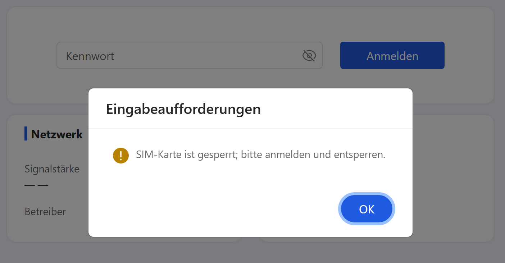
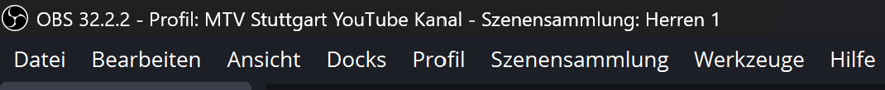
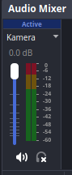
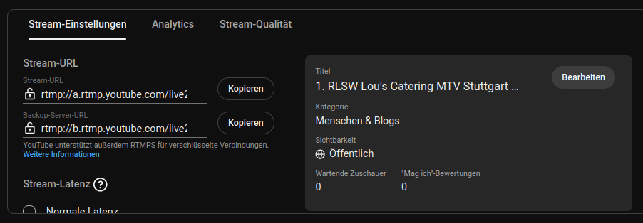

# Anleitung für Livestreams vom MTV Stuttgart

## Benötigte Hardware

- Streaming-Laptop (aktuell Olafs)
- Livestream Router (aktuell bei Olaf; **nicht zu verwechseln mit dem Scouting Router!**)
- Ein Handy mit DroidCam Pro um das Spiel zu filmen (aktuell Torstens Handy)
- Powerbank oder andere Stromversorgung fürs Handy
- Kamerastativ fürs Handy
- Spieldaten-Laptop (nur für H1; aktuell Rubens)
- RS232-USB Kabel (nur für H1, aktuell bei Ruben)

## Benötigte Software

- Dieses Repository beinhaltet alle wichtigen Dateien
- Alle Benutzernamen, Passwörter, Pins und Stream Keys sind in der WhatsApp-Gruppenbeschreibung

## Übersicht des Streaming Aufbaus

- Für den Stream wird OBS verwendet, das mehrere Quellen (Kamerabild, Spieldaten) miteinander verbindet und automatisch auf YouTube streamt.
- Die Kamera sendet die Daten über DroidCam. Dafür ist die Pro-Version notwendig (5 € im Jahr oder einmalig 15 €).
- Spieldaten:
    - Herren 1: Die Spieldaten werden automatisch mit Hilfe vom Spieldaten-Laptop von der Uhr ausgelesen. Auf diesem Laptop wird auch ein lokaler Server erstellt, welcher das Overlay als html-Seite erstellt und immer aktuell hält. Diese Seite wird in OBS eingelesen.
    - Damen 1: Die Spieldaten werden im offiziellen DBBL-Showroom manuell (2. Person) aktuell gehalten. Dort hat man auch mehrere Overlays zur Auswahl, die nach Bedarf ein- und ausgeschalten werden können. Dazu zählen unter anderem:
        - Spieldaten (mit und ohne Zeit und 24s)
        - Auszeiten
        - Schiedsrichter
        - einzelne Spielerinnenleistungen
        - Diese Overlays werden dann als html-Seite in OBS eingebunden
    - Wichtig ist, dass alle Geräte im selben WLAN sind, damit sie miteinander kommunizieren können. Die Laptops und Torstens Handy bekommen automatisch immer die gleiche IP-Adresse zugeteilt, damit man in den Programmen nichts anpassen muss. Falls andere Geräte oder ein anderer Router benutzt werden, müssen die IP-Adressen in OBS angepasst werden. Mehr dazu im Troubleshooting.
    - Die Laptops und der Livestream-Router werden rechts am Kampfgericht neben den 24s aufgebaut. Das Handy mit Stativ wird oben über der Tribüne mittig aufgebaut.

## Anleitung Livestream DBBL

Man braucht 2 Personen. Eine filmt das Spiel und eine steuert den Stream und die Overlays

### Vor dem Spiel
Man braucht 2 Personen. Eine filmt das Spiel und eine steuert den Stream und die Overlays
Vor dem Spiel
1. Router starten: bei der ersten Anmeldung nach einstecken des Routers muss die Sim-Karte aktiviert werden
    1. mit dem WLAN verbinden (Name und Passwort in WhatsApp Gruppe)
    2. Anmeldeseite sollte sich automatisch öffnen (wenn nicht, mit anderem Gerät probieren)
    3. das gleiche Passwort (lang, mit Buchstaben) nochmal eingeben: 
    4. den PIN-Code eingeben: 
3. Streaming-Laptop einrichten
    1. Tastatur mit Num Pad anschließen (wird für die Punkte benötigt)
    2. ggfs. Maus anschließen (erleichtert die Bedienung, geht aber ohne)
    3. mit dem WLAN verbinden
    4. OBS starten
       
    6. In der Menu-Leiste unter Profil „DBBL YouTube Kanal“ auswählen -> es wird auf dem DBBL YouTube Kanal gestreamt
    7. In der Menu-Leiste unter Szenensammlung „Damen 1" auswählen
2. Torstens Handy einrichten:
    1. mit dem WLAN verbinden
    2. DroidCam starten
    3. jetzt sollte in OBS das Kamerabild ankommen. Wenn nicht -> siehe Troubleshooting
4. Showroom einrichten: der Showroom ist für das Overlay verantwortlich
    1. im Web-Browser auf live.dbbl-data.de gehen
    2. Anmelden
    3. das aktuelle Spiel auswählen (-> „steuern“). in der DBBL-Anleitung unter dem Punkt 4 beschrieben
    4. im Showroom die Pre-Game Ansicht anklicken. Jetzt sollte in OBS ein Overlay mit dem aktuellen Tabellenplatz und Formkurve der Teams angezeigt werden (zusätzlich zum Handybild)
5. Livestream starten 
    1. in OBS auf „Livestream starten“ klicken
    2. mit einem separaten Gerät überprüfen, ob der Livestream auf dem DBBL kanal flüssig läuft (geduldig sein, letztes Mal hat es am Anfang gehakt, aber wurde dann flüssig)
6. mit dem Showroom vertraut machen
    1. die Schiedsrichter eintragen DBBL-Anleitung Punkt 9
    2. die DBBL-Anleitung durchlesen. Dort steht alles Wichtige drin. Wir zeigen nur Punkte und Teamfouls an, keine Spiel- und Wurfuhr.
    3. mit den verschiedenen Overlays rumspielen und testen
    4. testen ob man über die Tasten vom Num Pad die Punkte und Teamfouls ändern kann
Kurz vor dem Spiel und während dem Spiel
    1. in der DBBL-Anleitung ist alles gut beschrieben
    2. immer, wenn in der Halle Musik gespielt wird, muss der Stream stumm geschalten werden. Dazu in OBS bei Kamera im Audio Mixer auf das Lautsprechersymbol klicken:

**Nicht vergessen, das Mikro danach (Spielbeginn, Auszeitende) wieder einzuschalten!**

### Nach dem Spiel:
1. in OBS auf „Stream beenden“ klicken
2. im Showroom auf „alles aus“ klicken und abmelden

## Herren 1 und alle sonstigen Teams

### Vor dem Spiel

1. Router starten: bei der ersten Anmeldung nach einstecken des Routers muss die Sim-Karte aktiviert werden
    1. mit dem WLAN verbinden (Name und Passwort in WhatsApp Gruppe)
    2. Anmeldeseite sollte sich automatisch öffnen (wenn nicht, mit anderem Gerät probieren)
    3. das gleiche Passwort (lang, mit Buchstaben) nochmal eingeben: 
    4. den PIN-Code eingeben: 
3. Streaming-Laptop einrichten
    1. ggfs. Maus anschließen (erleichtert die Bedienung, geht aber ohne)
    3. mit dem WLAN verbinden
    4. OBS starten
       
    6. In der Menu-Leiste unter Profil „MTV Stuttgart YouTube Kanal“ auswählen -> es wird auf dem MTV Stuttgart YouTube Kanal gestreamt
    7. In der Menu-Leiste unter Szenensammlung „Herren 1" auswählen
2. Torstens Handy einrichten:
    1. mit dem WLAN verbinden
    2. DroidCam starten
    3. jetzt sollte in OBS das Kamerabild ankommen. Wenn nicht -> siehe Troubleshooting
4. Die allgemeinen Spieldaten aktualisieren
    1. Aufm Spieldaten-Laptop im Ordner „HTML_Server“ (/home/ruben/Documents/Code/MTV-Stuttgart-Livestreams/) die Datei „config.json“ doppelklicken
    2. Teamnamen aktualisieren
    3. Teamfarben aktualisieren. Diese müssen in Hex-Code eingegeben werden. [Hier](https://htmlcolorcodes.com/color-picker/) die Trikotfarbe auswählen und den Hex-Code (6-stellig und mit # beginnend) in der Config-Datei eintragen.
    4. Die config Datei speichern und schließen 
5. Spieldaten automatisch auslesen und im Livestream einbinden
    1. Spieldaten-Laptop per RS232 Kabel mit der Anzeige verbinden 
    3. „read_bodet.bat“ starten (Doppelklick -> run in terminal). Dies startet das Python Script, dass die Spieldaten von der Bodet Uhr ausliest und in einer JSON-Datei speichert.
    4. „launch_server.bat“ starten (Doppelklick -> run in terminal). Dies startet den lokalen Server, der aus der JSON-Datei die Spieldaten ausliest und eine html-Seite erstellt
    5. "get_standings.bat" starten (Doppelklick -> run in terminal). Dies llädt automatisch die aktuelle Liga-Tabelle runter
    8. In OBS aufm Streaming Laptop die Szene „Pre-Game“ auswählen
    7. Jetzt sollte das Spiel mit Tabelle und Spielbeginn in ... eingeblendet werden. Ansonten siehe Troubleshooting
6. Livestream starten
    1. Bei [YouTube Studio](https://studio.youtube.com/video/Mn9Pj1DWkXU/livestreaming) mit dem MTV-Account anmelden
    2. Livestream bearbeiten -> Livestream Titel anpassen 
    3. in OBS auf „Livestream starten“ klicken

### Während dem Spiel:
In OBS gibt es mehrere Szenen, die je nach Spielsituation aktiviert werden müssen. Da dies immer nur bei Pausen (Vor dem Spiel, Auszeiten oder Viertelpausen) notwendig ist, kann das von der 24s Zeitnehmerin übernommen werden. Es gibt folgende Szenen:
- In-Game: diese Szene ist immer im Spielbetrieb aktiv. Es wird das Standard-Overlay eingeblendet und es gibt Ton.
- Auszeit Heim / Auszeit Gast: diese Szene ist für Auszeiten gedacht. Die Musik ist stumm und es gibt ein kleines Feld über dem Overlay, das anzeigt, welches Team die Auszeit genommen hat.
- Viertelpause: diese Szene unterscheidet sich von „in-Game“ nur darin, dass sie stumm ist. Das Overlay mit Punkten und Zeit wird ganz normal angezeigt. In jeder Viertelpause muss diese Szene eingeblendet werden.
- Pre-Game: diese Szene ist stumm und das Overlay zeigt nur „Spielbeginn in...“ an. Sobald die Spieluhr auf 10:00 Minuten (für das 1. Viertel) gesetzt wird, muss man die die Szene zu „Viertelpause“ wechseln, weil sonst „Spielbeginn in 10:00“ angezeigt wird.
- Spielende: diese Szene ist stumm und zeigt das Spiel-Ende-Overlay an

**Bitte unbedingt daran denken, zu Spielbeginn, nach Viertelpausen und nach Auszeiten die In-Game Szene einzublenden!**

### Nach dem Spiel:
1. in OBS auf „Stream beenden“ klicken

## Erstmalige Einrichtung (am besten mit Ruben gemeinsam machen)

WIP

auf dem Streaming PC:
1. [OBS](https://obsproject.com/) installieren
2. [DroidCam-Plugin](https://droidcam.app/) für OBS installieren
3. Damen 1 und Herren 1 Profile importieren (./src/obs_data/)
4. Alle Szenen importieren (./src/obs_data/scenes/)
5. [Python](https://www.python.org/) installieren
6. ggfs. in read_clock.py den Port anpassen. Bei Linux ist es "/dev/ttyUSB0"

auf dem Handy:
1. [DroidCam](https://droidcam.app/) installieren und pro Version kaufen. Sonst ist ein Wasserzeichen zu sehen.
